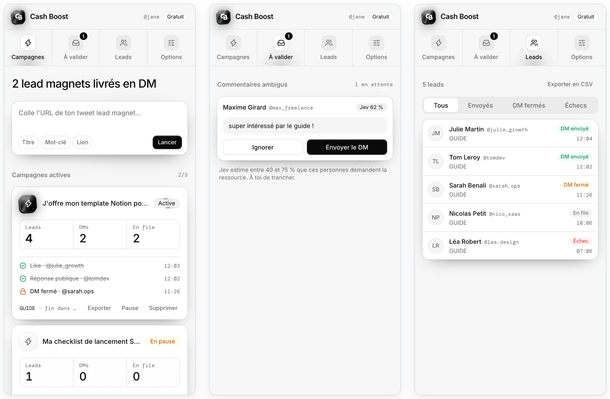

<p align="center">
  
</p>

<p align="center">
  Extension Chrome qui envoie votre lead magnet en DM aux personnes qui commentent votre tweet sur X.
</p>

<p align="center">
  <a href="LICENSE"></a>
  
  
</p>

<picture>
  <source media="(prefers-color-scheme: dark)" srcset="docs/screenshots/screenshots-dark.png">
  
</picture>

Vous postez « Commente GUIDE et je t'envoie mon template ». Cent personnes commentent. Sans outil, vous passez la soirée à copier-coller le lien dans cent DMs. Cash Boost le fait depuis votre navigateur, avec votre session X, au rythme d'une personne.

> [!WARNING]
> Automatiser des actions sur X est contraire à ses conditions d'utilisation. Votre compte peut être limité ou suspendu. L'extension le rappelle au premier lancement et s'arrête d'elle-même si X renvoie un signal de restriction. Vous l'utilisez à vos risques.

## Ce que fait l'extension

Pour chaque commentaire sous votre tweet :

1. **Elle décide si la personne demande le lien.** Le commentaire contient le mot-clé (casse, accents et emojis ignorés) : oui. Sinon, le modèle Jev (via OpenRouter) donne une probabilité : au-dessus de 0,8 le lead est traité, entre 0,4 et 0,8 il attend votre clic dans « À valider », en dessous il est ignoré.
2. **Elle vérifie qu'elle ne l'a pas déjà envoyé**, en relisant la conversation XChat avec la personne.
3. **Elle envoie le DM**, like le commentaire et répond publiquement. Si les DMs de la personne sont fermés, elle lui demande de les ouvrir et réessaie aux cycles suivants.

Le tweet est relu toutes les 5 à 15 minutes, moins souvent quand il se calme.

### Au rythme d'une personne

| | |
|---|---|
| Horaires | rien entre 21 h et 8 h par défaut (réglable dans Options), à 45 minutes près |
| Délais | courts le plus souvent, parfois longs, pause après quelques actions |
| DM | tapé mot à mot dans XChat, jamais deux fois la même variante à la suite |
| Réponses publiques | pas à tout le monde (environ 7 leads sur 10) |
| Quotas par jour | 20 DMs (60 avec X Premium), 100 réponses ; 30 likes par heure |
| Première semaine | quotas réduits, puis légèrement différents chaque jour |

Les valeurs sont dans [`packages/application/src/config.ts`](packages/application/src/config.ts).

### Vos données

Pas de serveur, pas de compte. Campagnes, leads et clé OpenRouter restent dans `chrome.storage.local`. Le texte d'un commentaire ne quitte le navigateur que pour être classé par Jev, envoyé directement à OpenRouter avec votre clé. Sans clé, seuls les commentaires qui contiennent le mot-clé sont traités. Le détail est dans la [politique de confidentialité](PRIVACY.md).

## Installation

L'extension n'est pas encore sur le Chrome Web Store : il faut la construire. Prérequis : Node.js 24 et pnpm 11.

```bash
git clone https://github.com/mathieuhq/cash-boost-chrome.git
cd cash-boost-chrome
pnpm install
pnpm build
```

1. Ouvrez `chrome://extensions`, activez le mode développeur.
2. « Charger l'extension non empaquetée » et choisissez `apps/extension/build/chrome-mv3-prod`.
3. Ouvrez x.com, connectez-vous, puis ouvrez le side panel de Cash Boost.
4. Facultatif : collez une [clé OpenRouter](https://openrouter.ai/keys) dans l'onglet Options pour que Jev classe les commentaires sans mot-clé (environ 0,04 $ par million de tokens).

Pour lancer une campagne, collez l'URL du tweet, indiquez le mot-clé et le lien, puis « Lancer ». Les variantes de messages et la durée de surveillance (24, 48 ou 72 h) se règlent une fois dans Options.

## Limites connues

- L'extension s'appuie sur l'API interne de x.com et sur l'interface de XChat. Quand X les modifie, l'extension cesse de fonctionner jusqu'à la version suivante. Si c'est la page des messages qui change, toutes les campagnes se mettent en pause.
- Le navigateur doit rester ouvert : rien ne tourne quand Chrome est fermé.
- Seules les réponses directes au tweet sont lues, pas les réponses aux réponses.
- L'interface est en français.

## Développement

```bash
pnpm dev        # extension en watch, à charger depuis apps/extension/build/chrome-mv3-dev
pnpm test       # tests Vitest, sans aucun appel réseau
pnpm typecheck
```

Monorepo pnpm + Turborepo en Clean Architecture :

```
apps/extension/          side panel et service worker (Plasmo, React, Tailwind v4, shadcn/ui)
packages/domain/         règles pures : campagne, mot-clé, lead, file d'actions
packages/application/    moteur de campagne et config par défaut
packages/adapters-x/     API interne de X et XChat
packages/adapters-chrome/ stockage, alarmes, onglets
packages/adapters-openrouter/ classification Jev
```

Trois choix expliquent l'essentiel du code :

- les appels X partent d'un onglet x.com ouvert, avec votre session ;
- les DMs passent par l'interface XChat, et seul le lien présent dans la conversation prouve l'envoi ;
- il n'y a pas de backend.

Le vocabulaire du domaine est dans [CONTEXT.md](CONTEXT.md).

## Contribuer

Issues et pull requests bienvenues. Le code est écrit en TDD : ajoutez un test pour tout changement de comportement et utilisez les termes de [CONTEXT.md](CONTEXT.md). `pnpm test` et `pnpm typecheck` doivent passer.

## Licence

[MIT](LICENSE)
