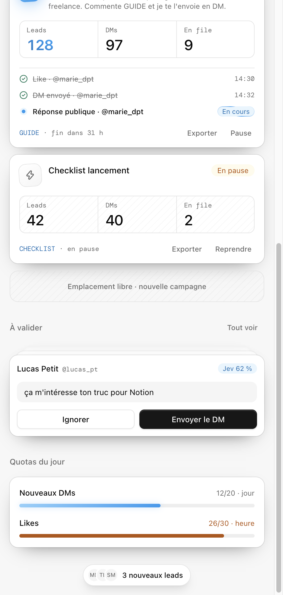

<p align="center">
  
</p>

<p align="center">
  Extension Chrome qui livre automatiquement vos lead magnets sur X.<br>
  Les gens commentent le mot-clé sous votre tweet. Cash Boost leur envoie le lien en DM, like leur commentaire et leur répond.
</p>

---

> [!WARNING]
> Cash Boost automatise des actions avec votre session X, ce que les conditions d'utilisation de X interdisent. Votre compte risque d'être restreint ou suspendu. L'extension affiche un avertissement à accepter au premier lancement. Vous l'utilisez à vos risques.

## Fonctionnement

1. Dans le side panel, vous créez une **campagne** : l'URL d'un de vos tweets, le mot-clé (« GUIDE »), le lien du lead magnet et quelques variantes de messages.
2. Toutes les 5 à 15 minutes, l'extension lit les réponses directes au tweet.
3. Chaque commentaire est classé :
   - le mot-clé est présent (après normalisation de la casse, des accents et des emojis) : le commentaire est retenu ;
   - sinon, le modèle [Jev](docs/adr/0006-classification-jev.md) estime si la personne demande le lead magnet. Au-dessus de 0,8 le commentaire est traité, entre 0,4 et 0,8 il attend votre validation en un clic, en dessous il est ignoré.
4. Pour chaque lead, l'extension regarde d'abord dans les DMs si le lien a déjà été envoyé. S'il ne l'a pas été, elle envoie le DM, puis like le commentaire et répond publiquement. Si les DMs sont fermés, elle répond « ouvre tes DMs » et retente à chaque cycle.

Les actions passent par une file cadencée par des délais aléatoires et des quotas par compte (DMs par jour, likes par heure, réponses par jour). Toutes les campagnes s'arrêtent si X renvoie un signal de restriction.

Vos campagnes, leads et files restent dans le navigateur (`chrome.storage.local`). Le backend ne gère que la connexion, les licences, la configuration distante et le proxy vers Jev. Il ne stocke jamais le texte des commentaires.

<p align="center">
  
</p>

La spécification complète est dans [docs/SPEC.md](docs/SPEC.md), le vocabulaire du domaine dans [CONTEXT.md](CONTEXT.md).

## Architecture

Monorepo TypeScript (pnpm + Turborepo), organisé en Clean Architecture ([ADR 0001](docs/adr/0001-clean-architecture-monorepo.md)) avec injection de dépendances manuelle ([ADR 0002](docs/adr/0002-injection-manuelle.md)).

```
apps/
  extension/          extension Chrome MV3 (Plasmo, React, Tailwind v4, shadcn/ui)
  backend/            API Hono + Better Auth + Drizzle/Postgres, déployée sur Vercel
packages/
  domain/             règles pures : campagne, mot-clé, lead, classification, file d'actions
  application/        moteur de campagne (Tick idempotent) et ports
  contracts/          schémas partagés entre l'extension et le backend
  adapters-x/         appels à l'API interne de X et parsing des réponses
  adapters-chrome/    stockage, alarmes, onglets x.com et XChat, connexion
  adapters-backend/   client HTTP du backend
docs/
  SPEC.md             spécification produit
  adr/                décisions d'architecture
  research/           faits vérifiés sur l'API X, Better Auth, Stripe, Jev et LearnHouse
  MISE-EN-SERVICE.md  création des comptes et mise en production
```

Points clés :

- Les appels X partent d'un onglet x.com ouvert, avec la session de l'utilisateur ([ADR 0004](docs/adr/0004-execution-x-dans-onglet.md)).
- Les DMs passent par l'interface web de XChat, dans un onglet épinglé dédié. Seule la présence du lien dans la conversation prouve qu'il a été envoyé ([ADR 0009](docs/adr/0009-dm-par-interface-xchat.md)).
- L'extension se connecte au backend avec Google, par un code à usage unique échangé contre un token bearer ([ADR 0007](docs/adr/0007-connexion-extension.md)).

## Démarrage

Prérequis : Node.js 24 et pnpm 11.

```bash
pnpm install
cp apps/backend/.env.example apps/backend/.env
cp apps/extension/.env.example apps/extension/.env.development
```

Dans `apps/backend/.env`, renseignez au minimum `BETTER_AUTH_SECRET` (`openssl rand -base64 32`). Sans `DATABASE_URL`, le backend utilise une base PGlite locale dans `.data/pglite`.

Pour fixer l'ID de l'extension, générez une clé puis copiez `CRX_PUBLIC_KEY` dans `apps/extension/.env.development` et l'ID affiché dans `EXTENSION_IDS` côté backend :

```bash
pnpm --filter @super-x/extension key
```

Lancez ensuite le backend et l'extension ensemble. Avec `--test`, la connexion utilise un compte local à la place de Google :

```bash
pnpm dev --test
```

Chargez enfin `apps/extension/build/chrome-mv3-dev` dans `chrome://extensions` (mode développeur, « Charger l'extension non empaquetée »).

## Commandes

| Commande | Effet |
|---|---|
| `pnpm dev` | backend sur `http://localhost:8787` et extension en watch |
| `pnpm test` | tests Vitest de tous les paquets, sans appel à un service externe |
| `pnpm typecheck` | vérification TypeScript |
| `pnpm build` | build de production du backend et de l'extension |

Le code est écrit en TDD ([ADR 0003](docs/adr/0003-tdd-strategie-de-test.md)) : le domaine et le moteur sont testés avec des fakes, le backend sur PGlite.

## Déploiement

Le backend dépend de Google OAuth, Neon, OpenRouter, Stripe, Resend et LearnHouse. Leur configuration et le déploiement Vercel sont décrits dans [apps/backend/README.md](apps/backend/README.md). L'extension et sa publication sur le Chrome Web Store sont décrites dans [apps/extension/README.md](apps/extension/README.md). La procédure complète de mise en service est dans [docs/MISE-EN-SERVICE.md](docs/MISE-EN-SERVICE.md).

## Contribuer

Les issues et pull requests sont bienvenues. Avant d'ouvrir une PR :

- utilisez les termes de [CONTEXT.md](CONTEXT.md) dans le code ;
- ajoutez des tests pour tout changement de comportement ;
- vérifiez que `pnpm test` et `pnpm typecheck` passent ;
- consignez toute décision d'architecture dans un nouvel ADR sous `docs/adr/`.

## Licence

[MIT](LICENSE)
